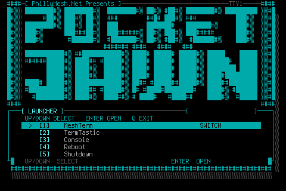
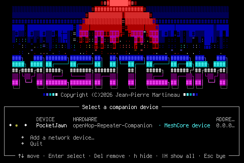
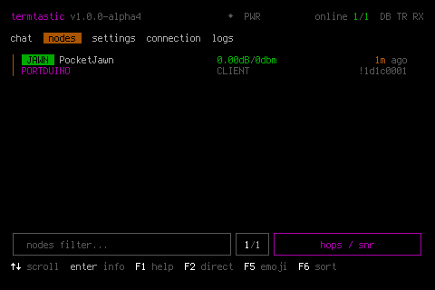

# PocketJawn

PocketTerm35 based Linux cyberdeck with a focus on MeshCore and Meshtastic integration and TUI based apps.

  

# Original plan

To make a hackable base device to run MeshTerm for MeshCore, something that could be modified while still using mostly off the shelf components, and not reinventing the wheel.

# Inevitable scope creep

Expanded the above to support a Meshtastic TUI, ANSI style main menu, reprogramming of some of the extra buttons to allow quick switching between TTYs, and slowly adding additional apps to support the general RF work around PhillyMesh.

  
  
  

# Interface & Controls

The base PocketTerm device has touchscreen support, while functional, I have not utilized it in my current build.

More interesting to me was the controller for the keyboard. It is an RP2040. The stock CircuitPython firmware already has the directional pad mapped as standard keyboard direction keys. However, the dedicated L/R "shoulder" buttons and the X/Y/B/A pad just mapped to the corresponding keyboard letters.

Since there is the RP2040 under the hood, that opened up some options. After some research I found the open-source work by black-ghost-off, which provided the Pico SDK/TinyUSB foundation that I used for PocketJawn’s custom controls.

Keeping the D-pad mapped as regular keyboard keys, I flashed new firmware that exposed the gamepad buttons as their own events. Then I set up a listener in Linux that takes the L/R button events and triggers the TTY switching logic.

So now, when you press the L/R gamepad keys you can quickly cycle through the TTYs that load at boot running the various apps.
